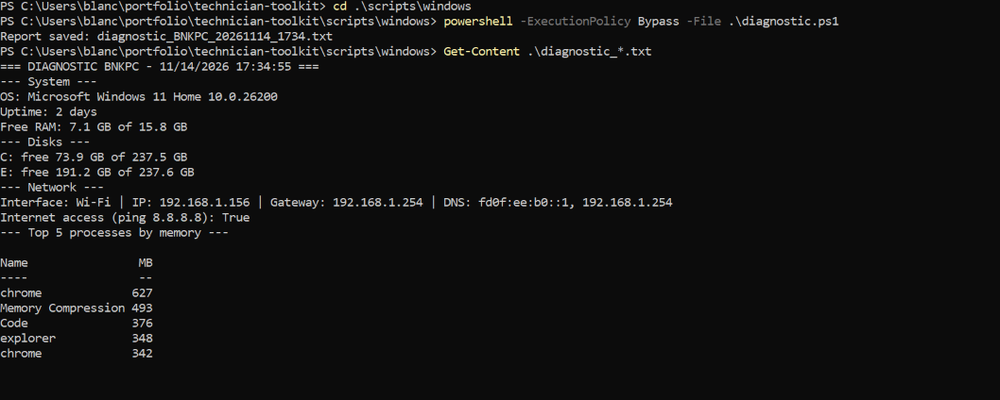
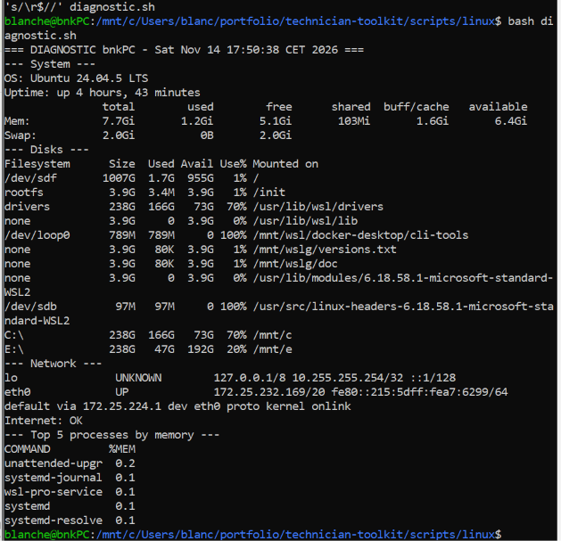
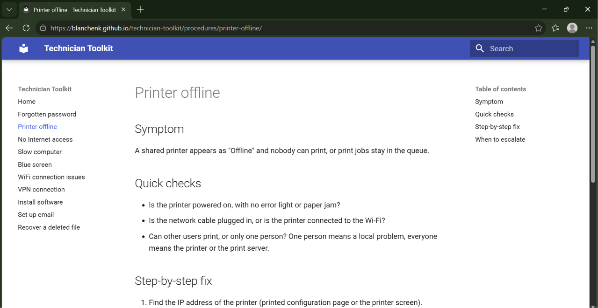
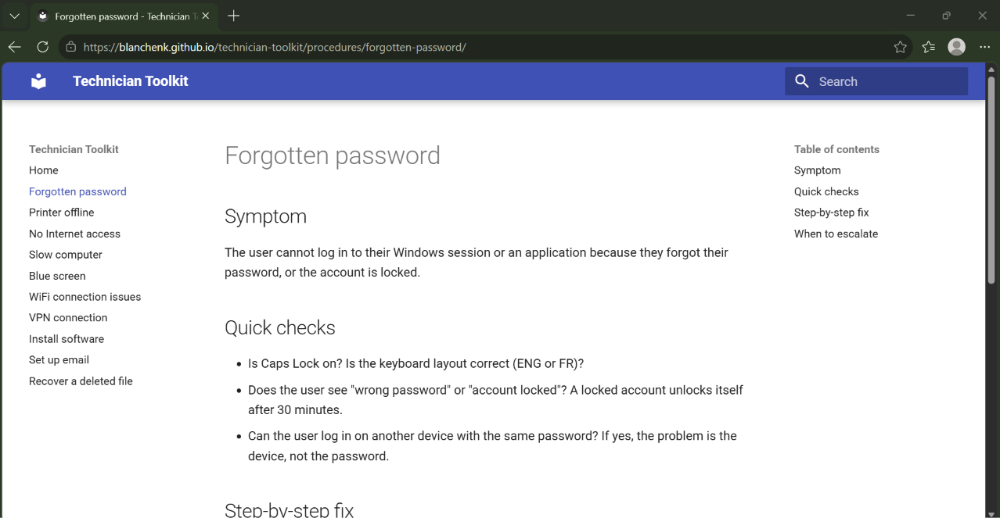

# Technician Toolkit

Windows and Linux diagnostic scripts and a 10-article troubleshooting knowledge base for IT support.

**Live knowledge base:** https://blanchenk.github.io/technician-toolkit/

## What this project shows

- Writing a diagnostic script for Windows (PowerShell) and Linux (Bash) that produces a clear text report
- Building and publishing a documentation site with MkDocs and GitHub Pages
- Writing troubleshooting procedures that follow one plan: symptom, quick checks, step-by-step fix, when to escalate
- Testing scripts on two systems (Windows 11 and Ubuntu 24.04 in WSL)

## Diagnostic scripts

Both scripts create a report file in the current folder with the same four sections: system, disks, network and the 5 processes using the most memory. A technician can ask a user to run one and read the report instead of asking ten questions.

| Script | System | Run it with |
|---|---|---|
| `scripts/windows/diagnostic.ps1` | Windows 10 and 11 | `powershell -ExecutionPolicy Bypass -File .\diagnostic.ps1` |
| `scripts/linux/diagnostic.sh` | Linux (tested on Ubuntu 24.04) | `bash diagnostic.sh` |

What each section tells you:
- **System:** operating system, time since the last restart, free memory. A PC that has not been restarted for weeks is a common cause of slowness.
- **Disks:** free space on each disk. Under 10 % free usually slows a PC down.
- **Network:** IP address, gateway, DNS and a ping to a public address. It shows where a connection problem starts.
- **Top 5 processes:** the programs using the most memory.

Example of a report:

The report files (`diagnostic_*.txt`) contain the name and the IP address of the machine, so they are ignored by Git and never published.

## Knowledge base

A site of 10 procedures, published with GitHub Pages: https://blanchenk.github.io/technician-toolkit/

| Procedure | Type |
|---|---|
| Forgotten password | Incident |
| Printer offline | Incident |
| No Internet access | Incident |
| Slow computer | Incident |
| Blue screen | Incident |
| Wi-Fi connection issues | Incident |
| VPN connection | Incident |
| Install software | Request |
| Set up email | Request |
| Recover a deleted file | Incident |

Each procedure has four parts: **Symptom**, **Quick checks**, **Step-by-step fix** and **When to escalate**.

## How to reproduce

1. Clone the repository: `git clone https://github.com/blanchenk/technician-toolkit.git`
2. Run a script on your machine (see the table above) and read the report.
3. To run the site locally, install Python, then run `python -m pip install mkdocs-material` and `python -m mkdocs serve`. Open `http://127.0.0.1:8000/`.
4. To publish it, run `python -m mkdocs gh-deploy` and enable GitHub Pages on the `gh-pages` branch.

## What I learned

- A good diagnostic starts at the lowest level and goes up: local network, Internet, then DNS
- Windows files use different line endings than Linux. A script written on Windows can fail on Linux, so `.gitattributes` forces LF for `.sh` files
- A `.gitignore` file must be saved and checked: mine was empty at first, and the reports almost got published
- Procedures are more useful when they say when to stop and escalate

## Limits

- The scripts only read information, they do not change the system
- The Linux script was tested on Ubuntu in WSL only
- The procedures are generic: adapt the IP addresses, the server names and the tools to your company